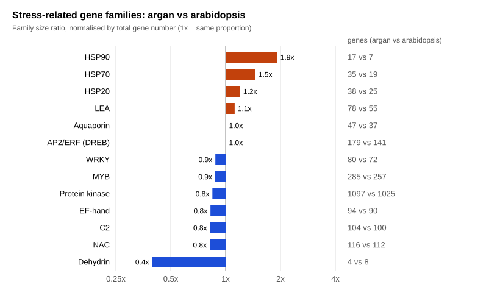
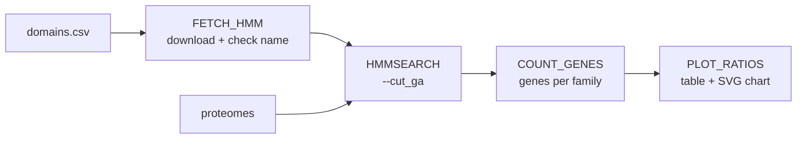

# argan-stress-domains

Comparison of **stress-response protein domain families** between the argan tree (*Argania spinosa*, now *Sideroxylon spinosum*) and the model plant *Arabidopsis thaliana*, with a reproducible **Nextflow** pipeline, **HMMER** and **Pfam** profiles.



## Background

The argan tree is endemic to south-western Morocco and grows in hot, arid conditions. This project revisits the analysis from my 3rd-year internship (INRA Morocco, summer 2024, supervised by Dr Slimane Khayi), where I searched the argan proteome for Pfam domains linked to drought tolerance.

This version is a **corrected and reproducible re-implementation**:

| Internship (2024) | This project |
| --- | --- |
| Pfam IDs typed by hand, several wrong (LEA and HSP families shifted) | IDs listed in `domains.csv`, each **checked automatically** against the Pfam name |
| Fixed E-value cut-off (`--domE 0.01`) | Official Pfam gathering thresholds (`--cut_ga`) |
| Counts of domain hits | Counts of **genes** (isoforms collapsed) |
| Argan only | Argan vs *Arabidopsis*, **normalised by total gene number** |
| Older draft genome | 2025 phased telomere-to-telomere assembly |
| Manual commands | Nextflow pipeline, Docker containers |

## Pipeline



1. **FETCH_HMM**: downloads each Pfam profile from InterPro and stops if its name differs from `domains.csv` (this check caught `PF03242`, renamed `LEA_3a` in current Pfam)
2. **HMMSEARCH**: searches all profiles in each proteome with HMMER 3.4
3. **COUNT_GENES**: counts the genes carrying at least one domain of each family
4. **PLOT_RATIOS**: computes the normalised ratio and draws the chart

## Quick start

Requirements: [Nextflow](https://www.nextflow.io/) (>= 25.10), [Docker](https://www.docker.com/), `curl`.

```bash
git clone https://github.com/omarelrhoul-cloud/argan-stress-domains.git
cd argan-stress-domains
./get_data.sh            # downloads the two proteomes into data/
nextflow run main.nf
```

Outputs in `results/`: `gene_counts.tsv`, `ratios.tsv`, `stress_families.svg` and the raw `hmmsearch/*.domtbl` tables.

To add or remove a domain, edit `domains.csv`. To compare other species, edit `data/proteomes.csv` and set `--target` / `--reference`.

## Results

Ratio = (family genes / total genes in argan) ÷ (family genes / total genes in *Arabidopsis*). Argan has 34,773 genes, *Arabidopsis* 27,496.

| Family | Argan genes | *Arabidopsis* genes | Ratio |
| --- | --- | --- | --- |
| HSP90 | 17 | 7 | 1.92 |
| HSP70 | 35 | 19 | 1.46 |
| HSP20 | 38 | 25 | 1.20 |
| LEA | 78 | 55 | 1.12 |
| Aquaporin | 47 | 37 | 1.00 |
| AP2/ERF (DREB) | 179 | 141 | 1.00 |
| WRKY | 80 | 72 | 0.88 |
| MYB | 285 | 257 | 0.88 |
| Protein kinase | 1097 | 1025 | 0.85 |
| EF-hand | 94 | 90 | 0.83 |
| C2 | 104 | 100 | 0.82 |
| NAC | 116 | 112 | 0.82 |
| Dehydrin | 4 | 8 | 0.40 |

**Sanity check:** the *Arabidopsis* counts match published family sizes (e.g. 72 WRKY, 7 HSP90), which supports the method.

**Observations:** heat shock protein families (HSP90, HSP70) are proportionally larger in argan, consistent with a tree adapted to hot, dry conditions. Dehydrins appear smaller.

**Limitations:** these are hypotheses, not conclusions. A larger family can reflect real gene duplications, but also annotation artefacts (a gene split in two is counted twice). The Pfam dehydrin profile is known to miss divergent dehydrins, whose conserved motifs are short. Expression data would be needed to link these families to drought tolerance.

## Data sources

- Argan proteome: El Idrissi H., Gkanogiannis A., Iraqi D., Khoulassa S., Fokar M., Badaoui B., Moussadek R., Mentag R., Khayi S. (2025). Phased telomere-to-telomere assembly of *Sideroxylon spinosum*, genome annotation files. [Zenodo record 16017913](https://zenodo.org/records/16017913)
- *Arabidopsis* proteome: [UniProt reference proteome UP000006548](https://www.uniprot.org/proteomes/UP000006548), one protein per gene
- Domain profiles: [Pfam](https://www.ebi.ac.uk/interpro/) via the InterPro API
- Search tool: [HMMER](http://hmmer.org/) 3.4 (`staphb/hmmer:3.4` container)

## Author

Omar ELRHOUL, bioinformatics engineer.
